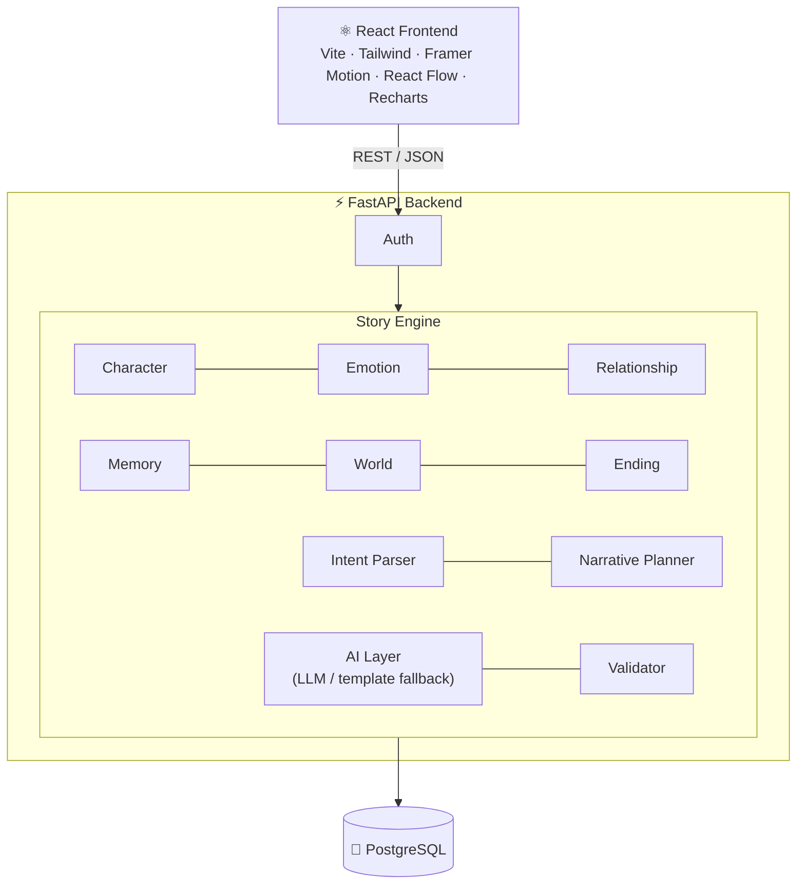

<div align="center">

# 幽玄 · Yūgen Mayoiga

### 幽玄迷い家

**An interactive, stateful narrative intelligence platform inspired by Japanese aesthetics**

*A story world you wander into, that reveals only part of itself, and fades once you leave.*

<br>

[🌸 Overview](#-overview) &nbsp;·&nbsp; [📈 Progress](#-current-progress) &nbsp;·&nbsp; [✨ Features](#-features) &nbsp;·&nbsp; [⚙️ How it works](#️-how-it-works) &nbsp;·&nbsp; [🧮 DSA](#-data-structures--algorithms) &nbsp;·&nbsp; [🧰 Tech stack](#-tech-stack) &nbsp;·&nbsp; [🗺️ Roadmap](#️-roadmap-8-weeks) &nbsp;·&nbsp; [👩‍💻 Author](#-author)

</div>

<br>

## 📌 At a Glance

| | |
|---|---|
| 🚀 **Status** | In development: **Week 1 complete ✅**, now on **Week 2** (DSA and story graph) |
| 🎯 **Next milestone** | **M1** (end of Week 2): engine and graph working in console |
| 📄 **Documentation** | Version 1.2 |
| 🎓 **Project type** | Major project, self-initiated, individual |
| ⏱️ **Duration** | 8 weeks |
| 🧰 **Stack** | React · FastAPI · PostgreSQL · Docker |
| 🤖 **AI / NLP** | LLM API or local model, sentence-transformers |

<br>

<table>
<tr>
<td width="33%" valign="top">

### 🧠 Stateful
Characters, relationships, memory and world variables persist and shape every scene.

</td>
<td width="33%" valign="top">

### 🛡️ Validated
Every scene is checked for consistency before it is shown to the player.

</td>
<td width="33%" valign="top">

### 🎐 Yūgen
Mystery is kept on purpose: hinted, never fully explained.

</td>
</tr>
</table>

---

## 📈 Current Progress

```text
▰▱▱▱▱▱▱▱   1 of 8 weeks complete
```

| | Week | Focus | Status |
|:---:|:---:|---|---|
| ✅ | 1 | Planning and core engine | **Complete** |
| 🔄 | 2 | DSA and story graph | **In progress** |
| ⬜ | 3-8 | Database, state engines, frontend, AI layer, aesthetics, final package | Upcoming |

### ✅ Week 1: Planning and core engine (done)

- [x] Scope and documentation finalised
- [x] GitHub repo, folders and virtual environment set up
- [x] ER diagram designed
- [x] Story, Character, Scene, Choice and StoryState classes implemented
- [x] Traits and emotion deltas
- [x] Hard-coded mini story running in the console

**Deliverable:** approved documentation, repo, console prototype.

### 🔄 Week 2: DSA and story graph (current)

- [ ] Story graph (nodes and edges) with branching
- [ ] Stack-based undo
- [ ] Event queue and priority queue
- [ ] BFS and DFS
- [ ] Cycle detection
- [ ] Reachable-ending check
- [ ] Unit tests for all of the above

**Deliverable:** tested graph and event modules, shown at **Milestone M1**.

<details>
<summary><b>🎬 M1 console demo plan (end of Week 2)</b></summary>

<br>

A console demo will show each structure working on the actual story data, independent of the web app:

1. Print the story graph as an adjacency list and run **BFS** to show the shortest path to every ending.
2. Run **DFS** to list all paths and highlight any dead ends.
3. Run **cycle detection** on a valid graph and on a graph with an injected loop.
4. Make five choices, then **undo** them one by one to show the stack restoring state.
5. Add events with different priorities and show them being fired in **priority order**.
6. Retrieve the **top 3 memories** for a query and show the score of each.

</details>

<details>
<summary><b>🧪 Week 2 test checklist</b></summary>

<br>

- [ ] **Graph:** small hand-built graph with known shortest distances; BFS output matches the expected result
- [ ] **Cycle detection:** one graph with a cycle, one without, and one whose only loop is marked `allow_loop`
- [ ] **Reachability:** a graph with a deliberately unreachable ending must be reported
- [ ] **Stack:** make N choices, undo N times, state equals the original
- [ ] **Heap:** insert events in random order, they pop in priority order
- [ ] **Top-k:** heap result matches a full sort on random data
- [ ] **LRU cache:** fixed get/put sequence with expected evictions *(built in Week 6)*

</details>

---

## 🌸 Overview

**Yūgen Mayoiga** is a web-based interactive narrative platform. You enter a story world, play a character, and make choices or type free-text actions. The system keeps a persistent **story state** (character personality and emotions, relationships, layered memory and world variables), plans each scene from that state, and uses an AI language model **only to write the prose**. Every scene is validated for consistency before you see it.

The interface follows Japanese aesthetics: ink-wash visuals, deliberate pauses, seasonal moods, and stories that hint at things instead of explaining everything.

> 🎯 **Core idea:** the story logic is deterministic and testable. The AI is only the writer, never the author of the rules.

### ❌ The problem

Most AI story tools produce one block of text from a prompt. Existing story generators:

- are **not stateful**,
- do **not model characters' psychology** over time,
- do **not guarantee consistency** in long stories,
- offer **limited interactivity** and emotional immersion.

### ✅ The solution

```text
Traditional :  Prompt → LLM → Fixed text
Yūgen       :  Choice → State → Rules → Memory → Planner → AI → Validator → New state → Scene
```

Deterministic engines (graph, rules, memory, planner, validator) decide **what happens**. The AI writes only **what the plan tells it to**.

---

## 🏯 The Name

**Yūgen (幽玄)** is a Japanese aesthetic concept of subtle, hidden depth: things that are suggested rather than fully revealed.
**Mayoiga (迷い家)** is a figure from Japanese folklore, recorded in *Tōno Monogatari* (1910) by Yanagita Kunio: a mysterious house that appears to travellers lost in the mountains, and cannot easily be found again once left.

| In the folklore / name | In the project |
|---|---|
| 🏠 The house appears to lost travellers | The player enters an unfamiliar story world (for example an abandoned seaside town) with incomplete information |
| 🌫️ It is hard to find again once left | Unchosen paths fade from the story map; replay shows the paths that were missed |
| 🔒 Its interior is never fully explained | Hidden variables and the Yūgen Meter keep some mystery unresolved |
| 🎐 Yūgen: depth that is hinted, not shown | Ambiguous clues, symbolic events and open-ended endings |

---

## 🎋 Japanese Aesthetic Foundation

These ideas are design principles for storytelling and interface design, **not decoration**.

| Concept | Meaning | In the project |
|---|---|---|
| **Yūgen** 幽玄 | Subtle, hidden depth | Hidden variables, ambiguous clues, unexplained details, and a Yūgen Meter that keeps some mystery unresolved |
| **Ma** 間 | Meaningful pause or empty space | Timed pauses before choices, silent "breath" scenes, minimal UI with generous whitespace |
| **Mono no aware** 物の哀れ | Gentle sadness at impermanence | Unchosen paths fade from the story map; emotional memories weaken with time; scenes end on quiet, bittersweet notes |
| **Wabi-sabi** 侘寂 | Beauty in imperfection | Flawed characters, incomplete endings, textured imperfect visual style |
| **Kintsugi** 金継ぎ | Repairing broken things with gold | Traumatic memories appear as "cracked" cards; when resolved, the cracks turn gold |
| **Kigo** 季語 | Seasonal words in haiku | Each story has a season (sakura, monsoon, snow) that changes mood, palette and world events |
| **Haiku / Tanka** | Compact poetic forms | Each chapter ends with a generated 5-7-5 style reflection |
| **Omikuji** おみくじ | Shrine fortune slips | Optional fate card at story start that adds a small hidden modifier |
| **Hanko** 判子 | Personal red stamp | Each ending is sealed with a stamp; collected stamps form the Endings Gallery |

---

## ✨ Features

Features are tiered. **Tier 1 must be completed**; Tier 2 and Tier 3 are added in order as time allows.

### 🟥 Tier 1: Core (MVP)

- [ ] Signup and login (JWT)
- [ ] Story creation wizard (genre, setting, tone, season, protagonist, theme, length)
- [ ] Character engine (traits, emotions, goals, secrets)
- [ ] Emotion and relationship engines
- [ ] World state engine
- [ ] Story graph with branching, undo (stack) and conditional endings
- [ ] Layered memory engine
- [ ] Narrative planner and AI scene generation (with template fallback)
- [ ] Basic consistency validator
- [ ] PostgreSQL persistence
- [ ] React story reader with choice buttons and character-state panel

### 🟨 Tier 2: Interactive and Japanese-aesthetic

- [ ] Free-text action input, mapped to an action by NLP and applied through the same rule engine
- [ ] Emotion-reactive UI: ink-wash background, particle effects (sakura, rain, snow), colour that changes with mood and season
- [ ] Typewriter text reveal with *Ma* pauses before choices
- [ ] Ambient soundscape (rain, wind, temple bell) with mute toggle
- [ ] **Yūgen Meter**: shows how much mystery remains without revealing numbers
- [ ] Kintsugi memory cards (cracked, then gilded)
- [ ] Haiku chapter closings
- [ ] Hanko ending seals and Endings Gallery
- [ ] Emotion radar chart and interactive relationship web
- [ ] Story map (React Flow) with unchosen paths fading

### 🟦 Tier 3: Advanced / stretch

<details>
<summary><b>Show stretch features</b></summary>

<br>

- [ ] Semantic memory retrieval with sentence-transformers
- [ ] Narration by text-to-speech (browser Web Speech API)
- [ ] Omikuji fate card at story start
- [ ] Replay / ghost-path mode showing where choices diverged
- [ ] Choice-influence heatmap
- [ ] Dynamic difficulty (pacing adapts to player behaviour)
- [ ] Emaki scroll export: finished story as a scroll-style PDF
- [ ] Dream / Mirror mode: a symbolic, surreal scene type triggered by high anxiety
- [ ] Achievement seals and daily story seed
- [ ] Light "Asa (morning)" and dark "Yoru (night)" themes with Japanese typography

</details>

---

## ⚙️ How It Works

### Architecture



### Scene generation pipeline


<details>
<summary><b>Planner output example (the <code>yugen_directive</code> keeps the mystery)</b></summary>

<br>

```json
{
  "location": "lighthouse",
  "season": "autumn rain",
  "mood": "uneasy",
  "characters": ["Aki", "Ren"],
  "conflict": "Aki suspects Ren is lying",
  "required_memory": "brother disappeared seven years ago",
  "goal": "raise suspicion without confirming it",
  "yugen_directive": "leave one detail unexplained",
  "possible_event": "the lamp turns on by itself"
}
```

The `yugen_directive` tells the AI to keep mystery deliberately, so the aesthetic is enforced by code rather than left to chance.

</details>

### 🧩 Core engines

| Engine | What it does |
|---|---|
| 🧍 **Character** | Identity, Big Five-inspired personality (0-100), emotions, goals, fears, secrets. Traits influence which choices are offered |
| 💭 **Emotion** | Events carry deltas (e.g. "friend disappears": fear +25, sadness +30, trust -10, anxiety +20). Values clamp to 0-100 and decay slowly over scenes |
| 🤝 **Relationship** | Directed edges (e.g. Aki to Ren) with trust, friendship, suspicion, fear and dependency |
| 🧠 **Memory** | Short-term, long-term, emotional and player-choice memories. Score = importance × recency × semantic similarity |
| 🌍 **World** | Key-value world state: weather, time, location, door and power status, NPC status, season |
| 🧭 **Intent Parser** | Maps free text to valid actions via embeddings, with keyword fallback, then asks to rephrase if needed |
| 🏁 **Ending** | Evaluates ending conditions; hidden variables and the Yūgen Meter shape the ending |

<details>
<summary><b>🛡️ Consistency validator</b></summary>

<br>

| Check | Example issue caught |
|---|---|
| Character | Age or background changes |
| World | Character walks through a locked door |
| Memory | Character forgets a major event |
| Timeline | Event occurs before it could have |
| Personality | Action clashes with current state |

Failing scenes are regenerated with the violations included in the prompt. After the retry limit, a safe template scene is used.

</details>

<details>
<summary><b>🏺 Kintsugi memories and the Yūgen Meter</b></summary>

<br>

- Memories with high negative emotional weight are marked **cracked**. When a related truth or resolution is reached, they become **gilded**, which is shown visually and can unlock better endings.
- Hidden variables (suspicion, truth_progress, dependency) are stored but not shown.
- The **Yūgen Meter** is a soft indicator of how much remains unspoken. It rises when the player leaves clues unexplored and falls as truths are revealed. Some endings deliberately require a high meter.

</details>

---

## 🧮 Data Structures & Algorithms

All core DSA code is written **from scratch** inside the `algorithms/` folder, with Python standard-library containers (`dict`, `deque`, `heapq`) as underlying storage where appropriate.

| Structure / algorithm | Used for | Time |
|---|---|---|
| 🕸️ **Graph** (adjacency list) | Story graph: scenes as nodes, choices as directed edges | add edge O(1), space O(V+E) |
| 🔍 **BFS** | Minimum number of choices to reach each ending | O(V+E) |
| 🌲 **DFS** | Enumerate all paths, find dead ends | O(V+E) |
| 🔁 **Cycle detection** (DFS colouring) | Detect unintended loops | O(V+E) |
| 🎯 **Reachability** | Confirm every ending can be reached | O(V+E) |
| 🗂️ **Hash map** | Character, world, memory and relationship state | avg O(1) |
| ↩️ **Stack** | Undo and choice history (stores deltas) | O(1) |
| 🚶 **Queue** (`deque`) | Event scheduling, BFS frontier | O(1) |
| ⛰️ **Priority queue** (heap) | Two-heap event system; top-k memories | O(log n) |
| 🏆 **Top-k selection** | Retrieve the k most relevant memories | O(n log k) |
| 🌳 **Tree** | Dialogue and decision trees | O(n) |
| 📐 **Cosine similarity** | Intent parser, semantic memory | O(d) per pair |
| ♻️ **LRU cache** (hash map + doubly linked list) | Cache generated scenes, save time and API calls | O(1) |
| 🪟 **Sliding window** (bounded deque) | Short-term memory (last N events) | O(1) |

<details>
<summary><b>Algorithm files and the week they are built</b> (🔄 = current Week 2 work)</summary>

<br>

| File (`algorithms/`) | Contents | Built in |
|---|---|---|
| 🔄 `story_graph.py` | Graph class (adjacency list), add_scene, add_choice, get_choices(state) | Week 2 |
| 🔄 `path_finder.py` | BFS, DFS, all_paths, cycle detection, reachability, dead-end check | Week 2 |
| 🔄 `history_stack.py` | Stack-based undo with delta records | Week 2 |
| 🔄 `priority_events.py` | Two-heap event system (scheduled and ready) and pending queue | Week 2 |
| 🔄 `state_store.py` | Hash-map based state with clamping and effect application | Week 1-2 |
| `dialogue_tree.py` | Tree node class and traversal | Week 4 |
| `memory_retrieval.py` | Bounded deque, top-k heap retrieval, recency scoring | Week 4 (keyword), Week 6 (semantic) |
| `lru_cache.py` | LRU cache from scratch | Week 6 |

</details>

---

## 🗄️ Database & API

<details>
<summary><b>🐘 Database design</b> (PostgreSQL, 3NF, transactions, JSON columns)</summary>

<br>

| Table | Main columns |
|---|---|
| `users` | id, username, email, password_hash, created_at |
| `stories` | id, user_id (FK), title, genre, theme, tone, season, length, status, created_at |
| `characters` | id, story_id (FK), name, role, age, background |
| `character_traits` | character_id (FK), openness, conscientiousness, extraversion, agreeableness, neuroticism |
| `character_states` | id, character_id (FK), scene_id (FK), fear, anxiety, anger, sadness, happiness, trust |
| `relationships` | id, story_id (FK), from_character (FK), to_character (FK), trust, friendship, suspicion, fear, dependency |
| `scenes` | id, story_id (FK), scene_number, content, location, mood, haiku, created_at |
| `choices` | id, scene_id (FK), choice_text, effects (JSON), next_scene_id (FK) |
| `story_states` | id, story_id (FK), current_scene_id (FK), hidden_variables (JSON), yugen_meter, updated_at |
| `world_states` | id, story_id (FK), key, value |
| `memories` | id, character_id (FK), event, type, importance, emotional_weight, status (normal/cracked/gilded), embedding |
| `events` | id, story_id (FK), description, priority, status, trigger_condition |
| `endings` | id, story_id (FK), name, conditions (JSON), seal_text |
| `user_endings` | id, user_id (FK), ending_id (FK), achieved_at |
| `user_choices_log` | id, story_id, scene_id, choice_id, free_text, timestamp |

Concepts demonstrated: normalisation (3NF), primary and foreign keys, indexes on `story_id` and `character_id`, transactions for atomic state updates, JSON columns for flexible rules.

</details>

<details>
<summary><b>🔌 REST API</b></summary>

<br>

| Method | Endpoint | Purpose |
|---|---|---|
| POST | `/auth/register`, `/auth/login` | Authentication |
| POST | `/stories` | Create story |
| GET | `/stories`, `/stories/{id}` | List / get stories |
| POST | `/stories/{id}/generate` | Generate opening or next scene |
| POST | `/stories/{id}/choice` | Submit a button choice |
| POST | `/stories/{id}/action` | Submit a free-text action |
| POST | `/stories/{id}/undo` | Backtrack |
| GET | `/stories/{id}/state` | Character, world and visible state |
| GET | `/stories/{id}/characters` | Characters |
| GET | `/stories/{id}/memories` | Memories with kintsugi status |
| GET | `/stories/{id}/relationships` | Relationship web data |
| GET | `/stories/{id}/graph` | Story map (nodes, edges, faded flags) |
| GET | `/stories/{id}/timeline` | Timeline |
| GET | `/stories/{id}/analytics` | Emotion history and choice-influence data |
| POST | `/stories/{id}/export` | Emaki scroll export |
| GET | `/users/me/endings` | Endings gallery |

</details>

---

## 🎨 UI / UX Design

**Screens:** Landing · Dashboard · Story Creation · Story Reader · Character · Relationships · Story Map · Timeline · Analytics · Ending

| Principle | Detail |
|---|---|
| 🕰️ **Ma** | A short, intentional pause before choices appear |
| ⬜ **Minimalism** | Large whitespace, few elements per screen |
| 🌦️ **Reactive mood** | Colour and particles change with emotional state and season |
| ♿ **Accessibility** | Reduced-motion mode, mute option, keyboard navigation, readable contrast |
| 🔤 **Typography** | Noto Serif JP for headings, a clean serif for story text |

**Palette**

| Colour | Role |
|---|---|
| ⬛ Sumi black | Ink, base |
| ⬜ Washi off-white | Paper, background |
| 🟥 Vermilion red | Hanko seals |
| 🟦 Indigo | Depth, mood |
| 🟨 Muted gold | Kintsugi |

---

## 🧰 Tech Stack

| Layer | Technology |
|---|---|
| 🖥️ Frontend | React, Vite, Tailwind CSS, Framer Motion, React Flow, Recharts, tsParticles |
| ⚡ Backend | Python, FastAPI, Pydantic, SQLAlchemy, Alembic |
| 🐘 Database | PostgreSQL |
| 🤖 AI / NLP | LLM API or local model (for example via Ollama), sentence-transformers |
| 🔐 Auth | JWT, bcrypt |
| 🐳 DevOps | Docker, Docker Compose, Git/GitHub |
| 🧪 Testing | pytest, Postman |

**Non-functional goals:** state update under 200 ms · scene generation under about 8 s including AI · AI failure falls back to templates with no lost state · bcrypt + JWT + input validation, no keys in code · responsive and keyboard accessible · full stack via Docker Compose.

---

## 📁 Project Structure

```text
Yugen-Mayoiga/
├── frontend/src/        components, pages, hooks, services, utils, assets
├── backend/app/
│   ├── main.py
│   ├── api/             auth.py, stories.py, characters.py, analytics.py
│   ├── models/  schemas/  database/  core/
│   └── services/        story_engine, character_engine, emotion_engine,
│                        relationship_engine, memory_engine, world_engine,
│                        ending_engine, intent_parser, narrative_planner, validator
├── ai/                  prompts, embeddings, templates
├── algorithms/          story_graph, path_finder, memory_retrieval, priority_events
├── database/            migrations, schema.sql
├── tests/
├── docs/                architecture.md, api.md, er-diagram.png, user-guide.md
├── docker-compose.yml
├── README.md
└── .gitignore
```

---

## 🚀 Getting Started

**Requirements:** Python 3.11+ · Node.js 18+ · PostgreSQL 15 · Docker · VS Code · Git. Any laptop with 8 GB RAM is enough if a hosted or free-tier AI API is used.

> 🚧 Setup and run instructions will be added as development progresses. The full stack is planned to run with Docker Compose.

---

## 🗺️ Roadmap (8 Weeks)

Build order: **engine → database and API → UI → AI → polish.**

✅ done &nbsp;·&nbsp; 🔄 in progress &nbsp;·&nbsp; ⬜ upcoming

| Week | Focus | Deliverable | Done |
|:---:|---|---|:---:|
| 1 | Planning and core engine | Approved documentation, repo, console prototype | ✅ |
| 2 | DSA and story graph | Tested graph and event modules | 🔄 |
| 3 | Database and backend I | Working REST API with persistence | ⬜ |
| 4 | State engines | Rule-driven story via API, no AI yet | ⬜ |
| 5 | Frontend I | Playable story in browser (template scenes) | ⬜ |
| 6 | AI layer | AI-driven, validated scenes and free-text actions | ⬜ |
| 7 | Interactive and Japanese-aesthetic features | Fully immersive UI | ⬜ |
| 8 | Testing, stretch and documentation | Final submission package | ⬜ |

| Milestone | When | Meaning |
|:---:|---|---|
| **M1** | End of Week 2 | Engine and graph work in console |
| **M2** | End of Week 4 | Full backend and persistent state |
| **M3** | End of Week 5 | Playable web app without AI |
| **M4** | End of Week 6 | AI scenes plus validation and free text |
| **M5** | End of Week 8 | Polished, tested, documented final project |

<details>
<summary><b>⚠️ Fallback rule if a week slips</b></summary>

<br>

Drop features in this order: **emaki export → heatmap → replay → omikuji → TTS → semantic retrieval** (use keyword fallback). Tier 1 and the Tier 2 items planned for Weeks 5-7 stay.

</details>

---

## 🧪 Testing

| Type | What is tested |
|---|---|
| Unit | Graph traversal, heap ordering, emotion deltas and decay, ending conditions |
| Integration | Action → state update → database commit |
| API | All endpoints (pytest, Postman) |
| Validator | Deliberately inconsistent scenes must be flagged |
| Intent parser | Sample free-text phrases mapped to the correct actions |
| Graph | Every ending reachable; no dead ends or unintended cycles |
| UI / UX | Manual checks for responsiveness, reduced-motion mode, mute |
| Playthroughs | At least 5 complete runs reaching different endings |

**Evaluation metrics:** ending reachability (100% target), validator catch rate on injected errors, intent-mapping accuracy on a small labelled phrase set, average scene generation time, and a simple usability feedback form from 5-10 classmates.

---

## 🔭 Future Scope

More genres and story templates · sharing of user-created stories · richer analytics · audio narration in multiple languages including Japanese and Hindi · a possible research paper on state-driven, validated narrative generation.

---

## ⚖️ Disclaimer

Psychological variables (traits, fear, trust and so on) are **fictional computational parameters** used for storytelling. The system does not diagnose, test or assess any real person.

---

## 👩‍💻 Author

**Rajneesh Kaur**
B.Tech CSE · 3rd Year, 5th Semester
Rayat Bahra University, Mohali, Punjab

<div align="center">

<br>

*幽玄 Yūgen Mayoiga*

</div>
