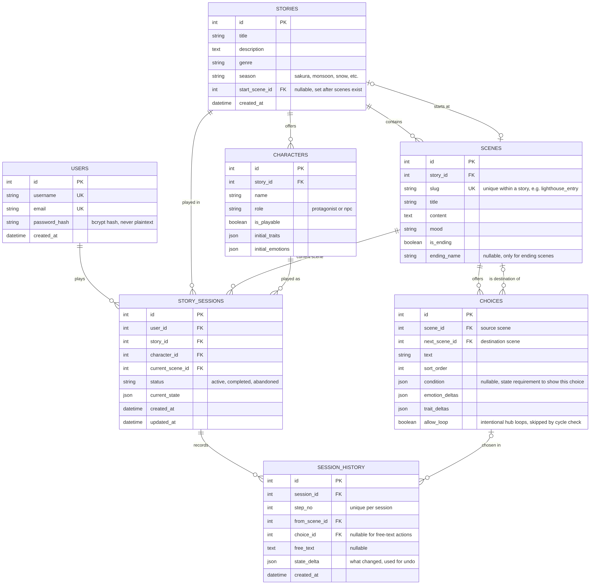

# Yūgen Mayoiga — Entity Relationship Diagram (ERD)

This diagram represents the planned logical database structure of Yūgen Mayoiga, including users, stories, scenes, choices, characters, story sessions, and session history.

Scenes represent graph nodes, while choices represent directed edges between scenes. The complete schema, relationships, constraints, and design decisions are documented in [`docs/database_design.md`](../../docs/database_design.md).

## ER Diagram

![Yūgen Mayoiga Entity Relationship Diagram]

