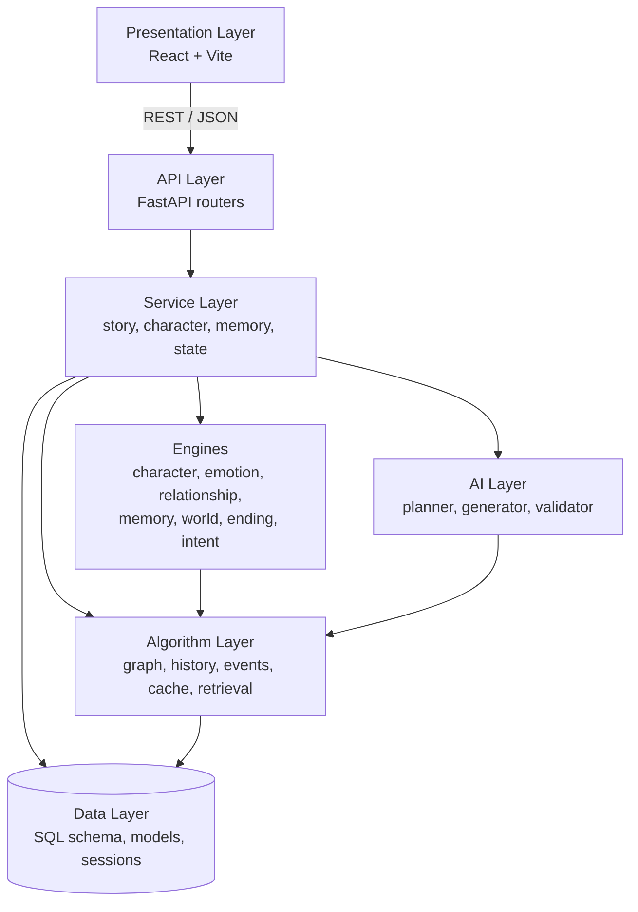
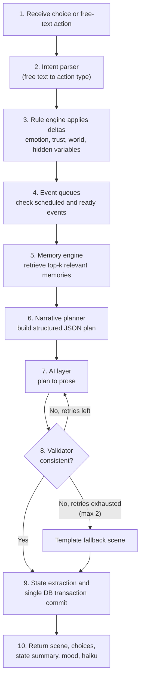
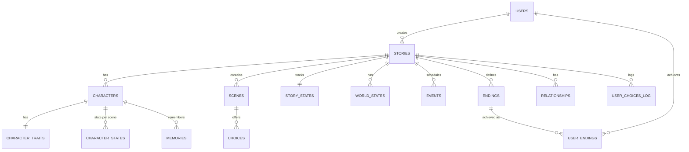

# Yūgen Mayoiga — System Architecture

> **Project:** Yūgen Mayoiga (幽玄迷い家), an interactive, stateful narrative platform
> **Author:** Rajneesh Kaur · **Guide:** Er. Ghanshayam · **Type:** Individual major project (8 weeks)
> **Document status:** Living document. Sections 1–12 describe the *design*; Section 13 tracks what is *actually implemented*. Always trust Section 13 over the design sections for the current state of the code.

---

## Table of Contents

1. [Overview](#1-overview)
2. [Architectural Principles](#2-architectural-principles)
3. [Technology Stack](#3-technology-stack)
4. [System Architecture](#4-system-architecture)
5. [Scene Generation Pipeline](#5-scene-generation-pipeline)
6. [Core Engines](#6-core-engines)
7. [Algorithms and Data Structures](#7-algorithms-and-data-structures)
8. [Data Architecture](#8-data-architecture)
9. [API Design](#9-api-design)
10. [Frontend Architecture](#10-frontend-architecture)
11. [Repository Structure](#11-repository-structure)
12. [Quality Attributes](#12-quality-attributes)
13. [Implementation Status](#13-implementation-status)
14. [Design Decisions](#14-design-decisions)
15. [Risks and Mitigation](#15-risks-and-mitigation)
16. [Roadmap](#16-roadmap)
17. [Limitations and Future Work](#17-limitations-and-future-work)

---

## 1. Overview

Yūgen Mayoiga is a web-based interactive narrative platform. The player enters a story world, plays a character, and acts through **choice buttons** or **free-text actions**. The system maintains a persistent story state (character personality and emotions, relationships, layered memory, world variables, hidden variables), plans each scene from that state, and uses an AI language model **only to write the prose**. Every generated scene is validated for consistency before the player sees it.

**The core idea: separate story logic from language generation.**

```text
Traditional:  Prompt -> LLM -> Fixed text
Yūgen:        Choice -> State -> Rules -> Memory -> Planner -> AI -> Validator -> New state -> Scene
```

Deterministic engines (graph, rules, memory, planner, validator) decide *what happens*. The AI writes only what the plan tells it to. This makes the system testable, consistent, and explainable.

**Design identity.** Japanese aesthetic concepts are used as architectural and UX principles rather than decoration:

| Concept | Where it shows up in the system |
|---|---|
| Yūgen (幽玄) | Hidden variables, `yugen_directive` in the planner output, the Yūgen Meter |
| Ma (間) | Timed pauses before choices, minimal UI |
| Mono no aware (物の哀れ) | Emotion decay over scenes, unchosen paths fading on the story map |
| Kintsugi (金継ぎ) | Memories marked `cracked`, then `gilded` when resolved |
| Kigo (季語) | Per-story season that drives mood, palette, and world events |

## 2. Architectural Principles

| # | Principle | What it means in practice |
|---|---|---|
| P1 | **Deterministic core, generative edge** | State changes are computed by rules and algorithms. The LLM never changes state directly. |
| P2 | **Plan, then write** | The AI receives a structured JSON plan, not an open prompt. |
| P3 | **Validate before show** | Every scene passes the consistency validator; failures trigger bounded retries. |
| P4 | **Always degrade gracefully** | If the AI fails or is unavailable, a template-based generator keeps the story playable. |
| P5 | **Atomic state updates** | A turn commits state in a single database transaction; no partial turns. |
| P6 | **Algorithms are independent modules** | `algorithms/` has no dependency on the web framework, so each module is testable in isolation. |
| P7 | **Layered dependencies** | Each layer talks only to the layer directly below it. |

## 3. Technology Stack

| Area | Technology | Notes |
|---|---|---|
| Backend | Python 3.11+, FastAPI, Pydantic, SQLAlchemy, Alembic | REST API with typed schemas |
| Frontend | React, Vite, JavaScript; planned: Tailwind CSS, Framer Motion, React Flow, Recharts, tsParticles | Story reader, graph and charts |
| Database | SQL schema and seed data; PostgreSQL 15 (target) | Normalised to 3NF, JSON columns for flexible rules |
| AI / NLP | LLM API or local model (e.g. via Ollama); sentence-transformers for embeddings | Template fallback always available |
| Auth | JWT, bcrypt | Planned |
| Testing | pytest, Postman | Unit, integration, algorithm tests |
| DevOps | Docker, Docker Compose, Git/GitHub, environment-variable configuration | |

## 4. System Architecture



| Layer | Responsibility | Location |
|---|---|---|
| **Presentation** | Story reader, choice and free-text input, character panel, analytics screens | `frontend/src/` |
| **API** | Endpoints for stories, scenes, characters, choices, memories, health | `backend/app/api/` |
| **Service** | Orchestrates a turn: story operations, character data, memory retrieval, state updates | `backend/app/services/` |
| **Engines** | Rule-driven domain logic (emotion deltas, relationships, endings, intent parsing) | `backend/app/services/` |
| **Algorithm** | Reusable DSA modules: graph traversal, undo stack, event heaps, LRU cache, top-k retrieval | `algorithms/` |
| **AI** | Narrative planning, context building, prose generation, consistency validation | `backend/app/ai/`, `ai/` |
| **Data** | Models, connection/session handling, SQL schema, seed data | `backend/app/models/`, `backend/app/database/`, `database/` |

## 5. Scene Generation Pipeline

Every player action runs through the same pipeline. This is the heart of the system.



**Narrative planner output (example).** The `yugen_directive` field enforces the aesthetic in code instead of leaving it to chance:

```json
{
  "location": "lighthouse",
  "season": "autumn rain",
  "mood": "uneasy",
  "characters": ["Aki", "Ren"],
  "conflict": "Aki suspects Ren is lying",
  "required_memory": "brother disappeared seven years ago",
  "goal": "raise suspicion without confirming it",
  "yugen_directive": "leave one detail unexplained",
  "possible_event": "the lamp turns on by itself"
}
```

**Consistency validator.** Failing scenes are regenerated with the violations included in the prompt.

| Check | Example issue caught |
|---|---|
| Character | Age or background changes |
| World | A character walks through a locked door |
| Memory | A character forgets a major event |
| Timeline | An event occurs before it could have |
| Personality | An action clashes with current state |

## 6. Core Engines

| Engine | Responsibility | Key rules |
|---|---|---|
| **Character** | Identity, Big Five-inspired traits (0–100), emotions, goals, fears, secrets | Traits influence which choices are offered and their likely outcomes (a curious character may be offered "investigate"; an anxious one "hide"). |
| **Emotion** | Applies event deltas to fear, anxiety, anger, sadness, happiness, trust | Values clamped to 0–100; slow decay over scenes so old feelings soften unless reinforced by memory. |
| **Relationship** | Directed edges between characters (trust, friendship, suspicion, fear, dependency) | Example: after a lie, trust 72 → 42, suspicion 15 → 55. |
| **Memory** | Four types: short-term, long-term, emotional, player-choice | Retrieval score = importance × recency × semantic similarity; top-k via heap. Heavy negative memories are `cracked`, then `gilded` on resolution. |
| **World** | Key-value world state (weather, time, location, door and power status, NPC status, season) | Read by the validator to reject impossible scenes. |
| **Intent parser** | Maps free-text actions onto valid scene actions | Embedding similarity above threshold → keyword/rule fallback → ask player to rephrase. Keeps free text inside the rule engine. |
| **Ending** | Evaluates ending conditions; maintains the Yūgen Meter | Conditions are expressions over visible and hidden variables (e.g. `trust > 70 AND truth_discovered`). |

**Hidden variables** (suspicion, truth_progress, dependency) are stored but never shown. The **Yūgen Meter** is a soft indicator of how much remains unspoken: it rises when clues are left unexplored and falls as truths are revealed.

## 7. Algorithms and Data Structures

All core DSA code is written from scratch in `algorithms/`, using Python standard-library containers (`dict`, `deque`, `heapq`) as underlying storage where appropriate.

| Module | Technique | Role in the engine | Time complexity |
|---|---|---|---|
| `story_graph.py` | Graph (adjacency list), BFS, DFS | Scenes as nodes, choices as directed edges with state conditions; BFS gives minimum choices to each ending; DFS enumerates paths and finds dead ends | Add edge O(1); traversal O(V+E) |
| `path_finder.py` | BFS/DFS, cycle detection (DFS node colouring), reachability | Detects unintended loops (edges marked `allow_loop` are skipped); confirms every ending is reachable | O(V+E) |
| `history_stack.py` | Stack of state deltas | Undo and choice history; stores deltas, not full state copies | Push/pop O(1) |
| `priority_events.py` | Two heaps + queue | Min-heap by `due_turn` holds scheduled events; due events move to a max-heap by `priority` so urgent events are never delayed behind ambience | Push/pop O(log n) |
| `state_store.py` | Hash map | Character, world, relationship, and hidden state with clamping and effect application | Average O(1) |
| `dialogue_tree.py` | Tree (pre-order traversal) | Branching conversations inside a scene; applies emotion deltas per node | Traversal O(n) |
| `memory_retrieval.py` | Bounded deque, top-k min-heap, cosine similarity | Short-term sliding window (last N events); top-k memory retrieval | O(1) per event; O(n log k) |
| `lru_cache.py` | Hash map + doubly linked list | Caches generated scenes keyed by plan hash to save time and API calls | Get/put O(1) |

**Why these choices.** The story graph is sparse (2–5 choices per scene), so an adjacency list uses O(V+E) space instead of O(V²). BFS is used for shortest path because the graph is unweighted. A size-k heap gives O(n log k) retrieval instead of sorting all memories at O(n log n).

**Known limitation.** Static graph analysis ignores runtime state conditions, so it gives the *structural* minimum. Runtime reachability with conditions is checked by simulated playthroughs.

Per-algorithm behavior and test coverage are documented in `algorithms/DSA_IMPLEMENTATION.md` and `docs/dsa_usage.md`.

## 8. Data Architecture



| Table | Main columns |
|---|---|
| `users` | id, username, email, password_hash, created_at |
| `stories` | id, user_id, title, genre, theme, tone, season, length, status, created_at |
| `characters` | id, story_id, name, role, age, background |
| `character_traits` | character_id, openness, conscientiousness, extraversion, agreeableness, neuroticism |
| `character_states` | id, character_id, scene_id, fear, anxiety, anger, sadness, happiness, trust |
| `relationships` | id, story_id, from_character, to_character, trust, friendship, suspicion, fear, dependency |
| `scenes` | id, story_id, scene_number, content, location, mood, haiku, created_at |
| `choices` | id, scene_id, choice_text, effects (JSON), next_scene_id |
| `story_states` | id, story_id, current_scene_id, hidden_variables (JSON), yugen_meter, updated_at |
| `world_states` | id, story_id, key, value |
| `memories` | id, character_id, event, type, importance, emotional_weight, status (normal/cracked/gilded), embedding |
| `events` | id, story_id, description, priority, status, trigger_condition |
| `endings` | id, story_id, name, conditions (JSON), seal_text |
| `user_endings` | id, user_id, ending_id, achieved_at |
| `user_choices_log` | id, story_id, scene_id, choice_id, free_text, timestamp |

**Database practices:** 3NF normalisation, primary and foreign keys, indexes on `story_id` and `character_id`, transactions for atomic turn commits, JSON columns for flexible rule data. Full details in `docs/database_design.md`.

## 9. API Design

| Method | Endpoint | Purpose |
|---|---|---|
| POST | `/auth/register`, `/auth/login` | Authentication |
| POST | `/stories` | Create story |
| GET | `/stories`, `/stories/{id}` | List and fetch stories |
| POST | `/stories/{id}/generate` | Generate opening or next scene |
| POST | `/stories/{id}/choice` | Submit a button choice |
| POST | `/stories/{id}/action` | Submit a free-text action |
| POST | `/stories/{id}/undo` | Backtrack one choice |
| GET | `/stories/{id}/state` | Character, world, and visible state |
| GET | `/stories/{id}/characters` | Characters |
| GET | `/stories/{id}/memories` | Memories with kintsugi status |
| GET | `/stories/{id}/relationships` | Relationship web data |
| GET | `/stories/{id}/graph` | Story map (nodes, edges, faded flags) |
| GET | `/stories/{id}/timeline` | Timeline |
| GET | `/stories/{id}/analytics` | Emotion history and choice-influence data |
| POST | `/stories/{id}/export` | Emaki scroll export (stretch) |
| GET | `/users/me/endings` | Endings gallery |
| GET | `/health` | Health check |

## 10. Frontend Architecture

| Screen | Contents |
|---|---|
| Landing | Animated ink-wash title, Start / Continue |
| Dashboard | My stories, Endings Gallery (hanko seals) |
| Story Creation | Step-by-step wizard (genre, setting, tone, season, protagonist, theme, length) |
| Story Reader | Typewriter narrative, mood-reactive background, choice buttons and free-text box, mini emotion bars, Yūgen Meter |
| Character | Traits, emotion radar chart, kintsugi memory cards |
| Relationships | Interactive relationship web |
| Story Map | React Flow graph with fading unchosen paths |
| Timeline / Analytics | Chapters and decisions, choice-influence heatmap, emotion line chart |
| Ending | Seal animation, haiku summary, replay and export |

**Interaction principles:** Ma pauses before choices; minimalism with generous whitespace; colour and particles react to emotion and season; palette of sumi black, washi off-white, vermilion, indigo, and muted gold; accessibility through reduced-motion mode, mute option, keyboard navigation, and readable contrast.

## 11. Repository Structure

```text
yugen-mayoiga/
├── ai/
│   ├── context/
│   ├── evaluation/
│   └── prompts/
├── algorithms/
│   ├── dialogue_tree.py
│   ├── history_stack.py
│   ├── lru_cache.py
│   ├── memory_retrieval.py
│   ├── path_finder.py
│   ├── priority_events.py
│   ├── state_store.py
│   ├── story_graph.py
│   ├── DSA_IMPLEMENTATION.md
│   └── tests/
├── backend/
│   └── app/
│       ├── ai/
│       ├── api/
│       ├── core/
│       ├── database/
│       ├── models/
│       ├── schemas/
│       ├── services/
│       ├── utils/
│       └── main.py
├── data/
├── database/
│   ├── schema/
│   └── seeds/
├── demo/
├── docs/
│   ├── weekly_progress/
│   ├── ai_design.md
│   ├── architecture.md
│   ├── database_design.md
│   ├── dsa_usage.md
│   ├── PRODUCT_BUILD_JOURNAL.md
│   ├── project_proposal.md
│   ├── testing.md
│   └── ui_wireframes.md
├── frontend/
│   └── src/
├── scripts/
├── tests/
│   ├── integration/
│   └── unit/
├── .env.example
├── docker-compose.yml
├── Dockerfile
├── README.md
└── LICENSE
```

| Directory | Purpose |
|---|---|
| `algorithms/` | Standalone DSA modules with their own tests (framework-independent) |
| `backend/app/` | FastAPI application: API, services, models, schemas, AI helpers, config |
| `ai/` | Prompts, context assets, and evaluation material for the AI layer |
| `database/` | SQL schema and seed data |
| `frontend/` | React application |
| `demo/` | Console demo for showing the DSA modules independently of the web app |
| `docs/` | Design documents and weekly progress notes |
| `tests/` | Unit and integration tests for the application |

## 12. Quality Attributes

| Category | Target | Strategy |
|---|---|---|
| Performance | State update < 200 ms; scene generation ≲ 8 s including AI | O(1) state access, LRU scene cache, short prompts |
| Reliability | No lost state; story playable without AI | Database transactions; template fallback; max 2 validator retries |
| Security | No plaintext passwords or keys in code | bcrypt hashing, JWT auth, input validation (Pydantic), secrets in environment variables only |
| Usability | Responsive, accessible | Keyboard navigation, mute and reduced-motion options |
| Maintainability | Modular and documented | Layered services, tested algorithm modules, documented API |
| Portability | One-command stack | Docker Compose |

**Configuration:** environment-specific settings live in environment files (see `.env.example`) and `backend/app/core/`. Secrets must never be committed to version control.

**Testing strategy**

| Type | Location | What is tested |
|---|---|---|
| Unit | `tests/unit/` | Emotion deltas and decay, ending conditions, heap ordering |
| Integration | `tests/integration/` | Action → state update → database commit |
| Algorithm | `algorithms/tests/` | Graph traversal, cycle detection, reachability, stack undo, heap order, top-k vs full sort, LRU eviction |
| Validator / intent parser | `tests/` | Deliberately inconsistent scenes are flagged; free-text phrases map to correct actions |
| Playthrough | manual and scripted | At least 5 complete runs reaching different endings |

Evaluation metrics: ending reachability (100% target), validator catch rate on injected errors, intent-mapping accuracy on a small labelled phrase set, average scene generation time. Testing claims in documentation must reflect tests that have actually been run and passed; see `docs/testing.md`.

## 13. Implementation Status

Update this table whenever a component changes state. Values: `Planned`, `In progress`, `Implemented`, `Tested`.

| Component | Status | Notes |
|---|---|---|
| Story graph: BFS | Implemented | In `story_graph.py` |
| Story graph: DFS | Implemented | In `story_graph.py` |
| Cycle detection / reachability | _update_ | |
| History stack (undo) | _update_ | |
| Priority events | _update_ | |
| State store | _update_ | |
| Dialogue tree | _update_ | |
| Memory retrieval | _update_ | |
| LRU cache | _update_ | |
| Backend API endpoints | _update_ | |
| Database integration | _update_ | |
| Auth (JWT) | _update_ | |
| Emotion / relationship / world / ending engines | _update_ | |
| AI: planner, generator, validator | _update_ | |
| Intent parser | _update_ | |
| Frontend | _update_ | |
| Docker setup | _update_ | |

This document describes the intended design and does not imply that every planned feature is complete.

## 14. Design Decisions

| Decision | Alternative considered | Rationale |
|---|---|---|
| LLM writes prose only; engines decide events | Let the LLM drive the story | Testable, consistent, and explainable; prevents the AI from breaking story logic |
| Story as a directed graph with state-conditioned edges | Linear script or free-form generation | Enables branching, shortest-path, reachability, and dead-end analysis |
| Adjacency list | Adjacency matrix | Sparse graph; O(V+E) instead of O(V²) space |
| Undo stack stores deltas | Store full state snapshots | Lower memory use; O(1) undo |
| Two-heap event system | Single sorted list | Due events are separated from priority ordering; urgent events never wait behind minor ones |
| Size-k heap for memory retrieval | Sort all memories | O(n log k) instead of O(n log n) |
| Embedding-based intent parser with keyword fallback | Keyword matching only | Handles varied phrasing; fallback keeps it working when similarity is low |
| Template fallback generator | Fail the request when AI is down | Story always stays playable |
| Core DSA written from scratch | Library implementations only | Demonstrates the algorithms for the DSA trainer; stdlib containers used only as storage |
| Hidden variables plus Yūgen Meter | Show all numbers | Keeps mystery deliberate, in line with the project's aesthetic |

## 15. Risks and Mitigation

| Risk | Mitigation |
|---|---|
| Scope too large for 8 weeks | Tiered features and a strict drop order for stretch items |
| AI output inconsistent or unavailable | Structured plan, validator with retries, template fallback |
| API cost or rate limits | Scene cache, short prompts, local model or mock mode in development |
| Story graph grows too large | One well-designed story template with a bounded number of nodes |
| Bugs in state updates | Transactions, automated tests, frequent commits |

## 16. Roadmap

| Milestone | Target | Meaning |
|---|---|---|
| M1 | End of Week 2 | Engine and graph work in console |
| M2 | End of Week 4 | Full backend and persistent state |
| M3 | End of Week 5 | Playable web app without AI |
| M4 | End of Week 6 | AI scenes with validation and free text |
| M5 | End of Week 8 | Polished, tested, documented final project |

**Fallback drop order** if time runs short: emaki export, heatmap, replay, omikuji, TTS, semantic retrieval (use keyword fallback).

## 17. Limitations and Future Work

- Static graph analysis ignores runtime conditions; runtime reachability depends on simulated playthroughs.
- Enumerating all simple paths can be exponential, so path counts are computed only for the bounded story template.
- Psychological variables (traits, fear, trust) are fictional computational parameters for storytelling. The system does not diagnose or assess any real person.
- Future scope: more genres and story templates, sharing of user-created stories, richer analytics, multilingual audio narration (including Japanese and Hindi), and a possible research paper on state-driven, validated narrative generation.