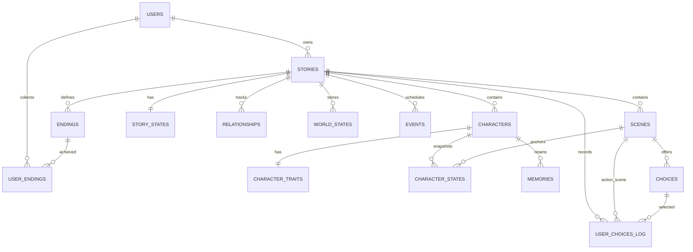

# Yūgen Mayoiga — Database Design

| Item | Details |
|---|---|
| Project | Yūgen Mayoiga (幽玄迷い家) |
| Developer | Rajneesh Kaur |
| Database target | PostgreSQL 15+ |
| ORM / migrations | SQLAlchemy + Alembic |
| Design phase | Week 1 |
| Database implementation | Week 3 |
| Related documents | `architecture.md`, `dsa_usage.md`, `project_proposal.md` |

## 1. Purpose and Scope

Yūgen Mayoiga is a stateful interactive story engine. A player explores scenes, selects choices or enters a free-text action, and the engine updates character emotions, relationships, memories, world variables and story progression.

The database is designed to support:

- User accounts and separate story playthroughs.
- Scenes and branching choices represented as a directed graph.
- Current story state and a history of player actions.
- Character traits, emotion snapshots and directed relationships.
- World variables, memories and scheduled events.
- Multiple endings and the Endings Gallery.
- Undo/replay support through an action log.
- Atomic saving: one player action must either save all its changes or save none.

**Implementation boundary:** Week 1 covers schema design and the ER diagram, plus in-memory Python classes for the console prototype. PostgreSQL, SQLAlchemy models and Alembic migrations are planned for Week 3. The complete schema below is the target design; it does not mean every table must be implemented in Week 1.

## 2. Core Design Decisions

1. **One `stories` row represents one player's playthrough.** Each playthrough owns its own scenes, characters and state. This avoids mixing progress between players.
2. **The database stores the current state and the action history.** Current-state tables make normal reads straightforward; the action log supports audit, undo and replay.
3. **Choices form the story graph.** A choice points from a source scene to a destination scene. A destination can be temporarily `NULL` while a generated scene is pending.
4. **Use relational columns for stable data and JSONB for flexible rules.** For example, choice effects and hidden variables are JSONB, while IDs, ownership and relationships are enforced with keys.
5. **Enforce cross-story consistency with composite foreign keys wherever practical.**
6. **Emotion history is stored by turn, not just by scene.** A player may revisit a scene and produce another emotion snapshot.
7. **Use transactions for every action.** State changes, the action log, memories, events and generated scene references must remain consistent.

## 3. Entity Relationship Diagram

The diagram is a conceptual overview. The composite keys described below add same-story integrity that a high-level ER diagram may not display clearly.

## 4. Tables and Important Fields

Conventions: primary keys use `BIGINT GENERATED ALWAYS AS IDENTITY`; timestamps use `TIMESTAMPTZ`; required fields are `NOT NULL`; and numeric emotion/trait/relationship values use `CHECK` constraints.

### 4.1 `users`

Stores account information.

| Column | Type | Rules |
|---|---|---|
| `id` | BIGINT | Primary key |
| `username` | VARCHAR(50) | Required, unique |
| `email` | VARCHAR(255) | Required, unique |
| `password_hash` | VARCHAR(255) | Required; store a password hash, never a plain password |
| `created_at` | TIMESTAMPTZ | Required, default `now()` |

### 4.2 `stories`

One row represents one player's playthrough.

| Column | Type | Rules |
|---|---|---|
| `id` | BIGINT | Primary key |
| `user_id` | BIGINT | FK → `users.id`, required, cascade on user deletion |
| `title` | VARCHAR(200) | Required |
| `genre` | VARCHAR(50) | Required |
| `theme` | VARCHAR(100) | Required |
| `tone` | VARCHAR(50) | Required |
| `season` | VARCHAR(30) | Required |
| `length` | VARCHAR(20) | Required; planned values: `short`, `medium`, `long` |
| `status` | VARCHAR(20) | Required, default `active`; allowed: `active`, `completed`, `abandoned` |
| `created_at` | TIMESTAMPTZ | Required, default `now()` |

Constraint: `CHECK (status IN ('active', 'completed', 'abandoned'))`.

### 4.3 `characters`

Stores the characters belonging to a playthrough.

| Column | Type | Rules |
|---|---|---|
| `id` | BIGINT | Primary key |
| `story_id` | BIGINT | FK → `stories.id`, required |
| `name` | VARCHAR(100) | Required; unique within a story |
| `role` | VARCHAR(50) | Required |
| `age` | SMALLINT | Nullable; if supplied, must be greater than zero |
| `background` | TEXT | Required, default empty string |
| `goals` | JSONB | Required, default `[]` |
| `fears` | JSONB | Required, default `[]` |
| `secrets` | JSONB | Required, default `[]` |

Constraints: `UNIQUE (story_id, name)`, `UNIQUE (id, story_id)`, and `CHECK (age IS NULL OR age > 0)`. The composite unique key `(id, story_id)` allows other tables to verify that a character belongs to the correct story.

The JSONB lists are intentionally kept with the character because they are normally read and updated together. If individual goals or fears later need complex querying, they can be moved into separate tables.

### 4.4 `character_traits`

Stores the character's stable Big Five-inspired personality values.

| Column | Type | Rules |
|---|---|---|
| `character_id` | BIGINT | Primary key and FK → `characters.id` |
| `openness` | SMALLINT | Required, 0–100 |
| `conscientiousness` | SMALLINT | Required, 0–100 |
| `extraversion` | SMALLINT | Required, 0–100 |
| `agreeableness` | SMALLINT | Required, 0–100 |
| `neuroticism` | SMALLINT | Required, 0–100 |

Each trait column has a `CHECK (column BETWEEN 0 AND 100)` constraint. Traits describe relatively stable personality; changing emotions are stored separately.

### 4.5 `scenes`

Stores the scenes in a story graph.

| Column | Type | Rules |
|---|---|---|
| `id` | BIGINT | Primary key |
| `story_id` | BIGINT | FK → `stories.id`, required |
| `scene_number` | INTEGER | Required; unique within a story |
| `content` | TEXT | Required; generated prose or template fallback |
| `location` | VARCHAR(100) | Required |
| `mood` | VARCHAR(50) | Required; can drive visual atmosphere |
| `haiku` | TEXT | Nullable; used for selected chapter endings |
| `is_ending` | BOOLEAN | Required, default `false` |
| `created_at` | TIMESTAMPTZ | Required, default `now()` |

Constraints: `UNIQUE (story_id, scene_number)` and `UNIQUE (id, story_id)`. The second constraint supports composite foreign keys.

### 4.6 `choices`

Choices are directed edges from one scene to another.

| Column | Type | Rules |
|---|---|---|
| `id` | BIGINT | Primary key |
| `story_id` | BIGINT | Required; used in composite foreign keys |
| `scene_id` | BIGINT | Required; source scene |
| `choice_text` | TEXT | Required |
| `effects` | JSONB | Required, default `{}`; state deltas |
| `condition` | JSONB | Nullable; conditions required to show a choice |
| `allow_loop` | BOOLEAN | Required, default `false`; marks an intentional loop |
| `sort_order` | SMALLINT | Required, default `0` |
| `next_scene_id` | BIGINT | Nullable while the destination scene is not generated |

Constraints:
- FK `(scene_id, story_id)` → `scenes(id, story_id)`.
- FK `(next_scene_id, story_id)` → `scenes(id, story_id)`.
- Deleting a source scene deletes its outgoing choices; destination references should use an appropriate restrictive or cascading policy chosen during migration design.

Example `effects`: `{"trust": -10, "fear": 5}`. Validate the JSON shape with a Pydantic schema before storing it. The database constraints guarantee that source and destination scenes belong to the same playthrough.

### 4.7 `story_states`

Stores the current state of a playthrough.

| Column | Type | Rules |
|---|---|---|
| `id` | BIGINT | Primary key |
| `story_id` | BIGINT | FK → `stories.id`, required and unique |
| `current_scene_id` | BIGINT | Required |
| `hidden_variables` | JSONB | Required, default `{}` |
| `yugen_meter` | SMALLINT | Required, default `0`, range 0–100 |
| `turn_number` | INTEGER | Required, default `0`, non-negative |
| `updated_at` | TIMESTAMPTZ | Required, default `now()` |

Constraint: composite FK `(current_scene_id, story_id)` → `scenes(id, story_id)`. `UNIQUE (story_id)` guarantees one current-state row per playthrough.

### 4.8 `character_states`

Stores emotion snapshots for a character at a particular turn. This allows the same scene to be revisited without overwriting an earlier snapshot.

| Column | Type | Rules |
|---|---|---|
| `id` | BIGINT | Primary key |
| `story_id` | BIGINT | Required |
| `character_id` | BIGINT | Required |
| `scene_id` | BIGINT | Required |
| `turn_number` | INTEGER | Required, non-negative |
| `fear` | SMALLINT | Required, 0–100 |
| `anxiety` | SMALLINT | Required, 0–100 |
| `anger` | SMALLINT | Required, 0–100 |
| `sadness` | SMALLINT | Required, 0–100 |
| `happiness` | SMALLINT | Required, 0–100 |
| `trust` | SMALLINT | Required, 0–100 |
| `created_at` | TIMESTAMPTZ | Required, default `now()` |

Constraints:
- FK `(character_id, story_id)` → `characters(id, story_id)`.
- FK `(scene_id, story_id)` → `scenes(id, story_id)`.
- `UNIQUE (character_id, turn_number)`.
- Each emotion must be between 0 and 100.

This design avoids the earlier problem with `UNIQUE (character_id, scene_id)`: revisiting the same scene can produce a new snapshot at a later turn.

### 4.9 `relationships`

Stores directed relationship values between two characters in the same story. `A → B` and `B → A` are separate directions because their feelings may differ.

| Column | Type | Rules |
|---|---|---|
| `id` | BIGINT | Primary key |
| `story_id` | BIGINT | Required |
| `from_character` | BIGINT | Required |
| `to_character` | BIGINT | Required |
| `trust` | SMALLINT | Required, 0–100 |
| `friendship` | SMALLINT | Required, 0–100 |
| `suspicion` | SMALLINT | Required, 0–100 |
| `fear` | SMALLINT | Required, 0–100 |
| `dependency` | SMALLINT | Required, 0–100 |

Constraints:
- FK `(from_character, story_id)` → `characters(id, story_id)`.
- FK `(to_character, story_id)` → `characters(id, story_id)`.
- `CHECK (from_character <> to_character)`.
- `UNIQUE (story_id, from_character, to_character)`.

The composite foreign keys prevent a relationship from accidentally linking characters from different stories.

### 4.10 `world_states`

Stores flexible world variables such as weather, time, door status or power state.

| Column | Type | Rules |
|---|---|---|
| `id` | BIGINT | Primary key |
| `story_id` | BIGINT | FK → `stories.id`, required |
| `key` | VARCHAR(100) | Required |
| `value` | JSONB | Required |
| `updated_at` | TIMESTAMPTZ | Required, default `now()` |

Constraint: `UNIQUE (story_id, key)`. JSONB is used for values because a world variable may be a number, string, boolean or small structured value.

### 4.11 `memories`

Stores character memories for short-term, long-term, emotional and player-choice recall.

| Column | Type | Rules |
|---|---|---|
| `id` | BIGINT | Primary key |
| `story_id` | BIGINT | Required |
| `character_id` | BIGINT | Required |
| `event` | TEXT | Required |
| `type` | VARCHAR(20) | Required; `short_term`, `long_term`, `emotional`, `player_choice` |
| `importance` | SMALLINT | Required, 0–100 |
| `emotional_weight` | SMALLINT | Required, -100 to 100 |
| `status` | VARCHAR(10) | Required, default `normal`; `normal`, `cracked`, `gilded` |
| `created_turn` | INTEGER | Required, non-negative |
| `embedding` | REAL[] | Nullable; optional Week 6 semantic retrieval |

Constraints:
- FK `(character_id, story_id)` → `characters(id, story_id)`.
- `CHECK` constraints for the ranges and controlled values.

`embedding` is optional and may remain unused if semantic retrieval is outside the available project time. A vector extension can be considered later; it is not a Week 1 requirement.

### 4.12 `events`

Stores scheduled events for the event-queue and priority-queue modules.

| Column | Type | Rules |
|---|---|---|
| `id` | BIGINT | Primary key |
| `story_id` | BIGINT | FK → `stories.id`, required |
| `description` | TEXT | Required |
| `priority` | SMALLINT | Required, default `0` |
| `due_turn` | INTEGER | Required, non-negative |
| `status` | VARCHAR(10) | Required, default `pending`; `pending`, `ready`, `done` |
| `trigger_condition` | JSONB | Nullable |

The Python engine defines how priority and due-turn ordering work. Database rows persist the event queue between requests.

### 4.13 `endings`

Stores ending definitions and the conditions required to reach them.

| Column | Type | Rules |
|---|---|---|
| `id` | BIGINT | Primary key |
| `story_id` | BIGINT | FK → `stories.id`, required |
| `name` | VARCHAR(100) | Required, unique within a story |
| `conditions` | JSONB | Required; ending conditions |
| `seal_text` | VARCHAR(50) | Required; text for the hanko seal |

Constraint: `UNIQUE (story_id, name)`. Application validation checks whether an ending's conditions can be evaluated against the current state.

### 4.14 `user_endings`

Tracks endings achieved by a user.

| Column | Type | Rules |
|---|---|---|
| `id` | BIGINT | Primary key |
| `user_id` | BIGINT | FK → `users.id`, required |
| `ending_id` | BIGINT | FK → `endings.id`, required |
| `achieved_at` | TIMESTAMPTZ | Required, default `now()` |

Constraint: `UNIQUE (user_id, ending_id)`. If ending records are permanently tied to a playthrough, application logic must verify that the user owns the story associated with the ending. A later schema revision may add `story_id` and composite foreign keys if this check should be enforced entirely by the database.

### 4.15 `user_choices_log`

Records button choices and free-text actions. The log supports timeline, undo, replay and debugging.

| Column | Type | Rules |
|---|---|---|
| `id` | BIGINT | Primary key |
| `user_id` | BIGINT | FK → `users.id`, required |
| `story_id` | BIGINT | FK → `stories.id`, required |
| `turn_number` | INTEGER | Required, non-negative |
| `scene_id` | BIGINT | Required; scene where the action was taken |
| `choice_id` | BIGINT | Nullable; set for a button choice |
| `free_text` | TEXT | Nullable; set for a typed action |
| `parsed_action` | VARCHAR(100) | Nullable; action identified by the parser |
| `delta` | JSONB | Required, default `{}`; records state changes |
| `undone` | BOOLEAN | Required, default `false` |
| `created_at` | TIMESTAMPTZ | Required, default `now()` |

Constraints:
- `CHECK (choice_id IS NOT NULL OR free_text IS NOT NULL)`.
- `UNIQUE (story_id, turn_number)`.
- Composite FK `(scene_id, story_id)` → `scenes(id, story_id)`.
- A composite FK from `choice_id` to a choice in the same story should be added after ensuring `choices` has `UNIQUE (id, story_id)` and the log stores the matching `story_id`.

The log should be treated as append-only for normal play. Undo should mark an action as undone or create a compensating action rather than silently deleting history.

## 5. Integrity Rules

1. **Ownership:** a story belongs to one user.
2. **Same-story links:** a choice's source and destination scenes, the current scene, character snapshots and relationship participants must belong to the same story.
3. **Single current state:** each playthrough has at most one `story_states` row.
4. **Range checks:** traits, emotions, relationships, importance and Yūgen Meter use defined numeric ranges.
5. **Controlled values:** statuses and memory types are restricted to documented values.
6. **No duplicate pairs:** scene numbers, character names within a story, relationship directions, world-variable keys and achieved user-ending pairs are unique.
7. **Input validation:** validate JSONB structures with Pydantic before saving. SQL constraints alone do not validate the full semantics of JSON rules.
8. **Atomic actions:** save state updates, action logs, memory changes, event changes and scene updates inside one database transaction.
9. **Ownership authorization:** API endpoints must verify that the authenticated user owns the requested story. A foreign key alone does not enforce API authorization.
10. **Graph rules:** rules such as “every non-ending scene should have a valid outgoing choice” and “each required ending is reachable” are checked by application logic and graph tests.

## 6. Index Plan

PostgreSQL creates indexes for primary keys and unique constraints, but not automatically for every foreign key. Add indexes for frequent queries after reviewing actual query patterns.

| Index | Purpose |
|---|---|
| `stories(user_id, created_at)` | List a user's stories |
| `characters(story_id)` | Load characters for a playthrough |
| `scenes(story_id, scene_number)` | Load scenes in order; covered by the unique constraint |
| `choices(scene_id, sort_order)` | Load choices for a scene |
| `choices(next_scene_id)` | Find inbound graph edges |
| `character_states(character_id, turn_number)` | Load emotion history |
| `relationships(story_id)` | Load the relationship web |
| `world_states(story_id)` | Load world variables |
| `memories(character_id, status, created_turn)` | Retrieve memories for a character |
| `events(story_id, status, due_turn, priority)` | Find due events |
| `user_choices_log(story_id, turn_number)` | Load action history and support undo |

Avoid adding every possible index before the application exists. Confirm query patterns and use `EXPLAIN ANALYZE` when performance tuning becomes relevant.

## 7. Feature-to-Table Mapping

| Feature | Main tables |
|---|---|
| Register/login | `users` |
| Create a story | `stories`, `characters`, `character_traits`, `scenes`, `choices`, `endings` |
| Render a scene and its choices | `scenes`, `choices`, `story_states` |
| Apply a player action | `user_choices_log`, `story_states`, `character_states`, `relationships`, `world_states` |
| Undo/replay | `user_choices_log`, current-state tables |
| Character emotion history | `character_traits`, `character_states` |
| Relationship web | `relationships` |
| Memories and kintsugi cards | `memories` |
| Scheduled events | `events` |
| Ending conditions and gallery | `endings`, `user_endings` |
| Save/resume/delete a playthrough | `stories`, `story_states` and dependent tables |

## 8. Transaction Flow for a Player Action

A single action should be processed in one database transaction:

1. Verify that the authenticated user owns the playthrough.
2. Load and lock the current `story_states` row as needed to prevent simultaneous actions from overwriting one another.
3. Validate the selected choice or parsed free-text action.
4. Apply the choice effects and update emotion, relationship, world and hidden-variable state.
5. Update the turn number and current scene; create memory/event records when required.
6. Insert the action-log row with the applied delta.
7. Commit only if all required operations succeed; otherwise roll back.

The exact locking strategy will be chosen during backend implementation. Week 1 only documents the intended behavior.

## 9. Testing Checklist

Database integration tests planned for Week 3 should verify:

- A choice cannot connect scenes from different stories.
- The current scene cannot belong to a different story than its `story_states` row.
- A character snapshot cannot combine a character and scene from different stories.
- A relationship cannot connect characters from different stories or a character to itself.
- Emotion/trait/relationship values outside their allowed ranges are rejected.
- A second `story_states` row for the same story is rejected.
- Duplicate scene numbers, character names within one story, and duplicate directed relationships are rejected.
- A log entry must contain a choice or free-text action.
- A failed action rolls back all related changes.
- A user cannot read or modify another user's playthrough through the API.
- Deleting a playthrough removes its dependent records according to the chosen cascade policy.
- Graph tests check cycles, valid edges and reachability of intended endings.

## 10. Database Concepts Demonstrated

| Concept | Use in Yūgen Mayoiga |
|---|---|
| Primary and foreign keys | Identify records and connect related entities |
| Composite foreign keys | Prevent cross-story references |
| Normalization | Separate traits, emotion snapshots, relationships, memories and events |
| Constraints | Enforce ranges, required fields and uniqueness |
| Indexes | Speed up frequent lookups |
| Transactions | Keep a player's action and its state changes consistent |
| JSONB | Store flexible choice effects, conditions and hidden variables |
| Migrations | Track schema changes through Alembic |
| ORM | Map Python models to database tables through SQLAlchemy |

### Normalization notes

- **1NF:** ordinary columns hold single values. A few JSONB columns intentionally store flexible lists or rule objects that are handled as a whole.
- **2NF:** non-key attributes describe the complete key for their table.
- **3NF:** stable personality traits, current state, emotion history, memories and relationships are separated where they have distinct responsibilities.
- JSONB is a deliberate flexibility choice, not a claim that every nested structure is fully normalized. If the project later needs to query individual goals, fears or secrets frequently, those should be moved to child tables.

## 11. Eight-Week Implementation Plan

The schema is the target design; implement it incrementally rather than building all tables at once.

| Week | Focus | Database-related deliverable |
|---|---|---|
| 1 | Planning and core engine | Finalize this document and ER diagram; implement in-memory `Story`, `Character`, `Scene`, `Choice` and `StoryState` classes; prototype a mini-story in the console |
| 2 | DSA and story graph | Implement graph traversal, stack-based undo, cycle detection, ending reachability and event queues; keep data structures independent of PostgreSQL |
| 3 | Database and backend | Create schema, SQLAlchemy models, Alembic migrations, seed data, authentication and core FastAPI endpoints |
| 4 | State engines | Persist emotion, relationship, world, memory, hidden-variable and ending updates; add transaction tests |
| 5 | Frontend | Connect story reader, dashboard and story-creation flow to the API |
| 6 | AI layer | Validate planner output, generated scenes and free-text actions before persistence |
| 7 | Interactive features | Add queries for emotion history, relationship web, memory cards, story map and endings gallery |
| 8 | Testing and polish | Test multiple playthroughs, constraints, rollback and deletion; finalize schema/ER diagram, README, demo and report |

### Week 1 completion checklist

- [ ] Confirm the project scope and key entities.
- [ ] Save this database design in `docs/database_design.md`.
- [ ] Export the ER diagram to `docs/er-diagram.png` (or keep the Mermaid diagram in the Markdown until export).
- [ ] Complete `Story`, `Character`, `Scene`, `Choice` and `StoryState` in Python using in-memory data.
- [ ] Define stable character traits and emotion-delta behavior.
- [ ] Run a hard-coded mini-story in the console.
- [ ] Update `docs/architecture.md` and `docs/weekly_progress/week_01.md`.

**Week 1 does not require PostgreSQL, migrations, JWT authentication or all 15 tables to be implemented.** Those are later deliverables.

## 12. Assumptions and Deferred Decisions

- `stories` represents a single user's playthrough, not a reusable shared story template. If shared templates are added later, introduce a separate `story_templates` entity.
- `user_endings` currently records achievements at the user level. If achievements must be scoped to a particular playthrough, add `story_id` and enforce ownership through composite foreign keys.
- `next_scene_id` may be nullable while a generated destination is pending. The application must ensure a playable choice does not remain unresolved when it is presented to the player.
- The precise deletion policy for scene destinations, action logs and achieved endings must be finalized in migrations. Prefer preserving audit history when it is useful, and avoid accidental cascade deletion of records that should remain.
- Semantic memory retrieval, embeddings, replay analytics and heatmaps are optional enhancements; they must not block the Week 1 core engine.

